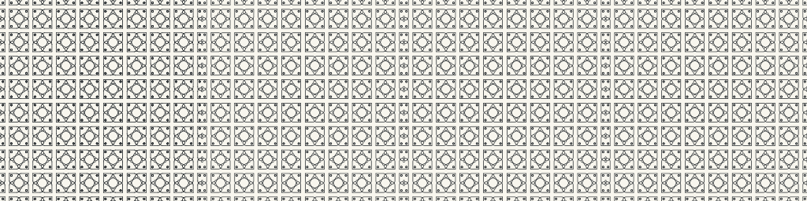

# Native stroke geometry seam, version 1

`subpixel.mjs` exports the **existing** `parsePattern` / `enumerateOrbit` result.
Those functions remain the parser and group-action owners. Motif shape records,
generator records, orbit order, and the SVG renderer are unchanged. The exporter
does not reimplement a wallpaper group in C, Idriç, or another language.

## Types and ownership

Input: a parsed `Pattern` with canvas size, viewport, ordered draw/orbit commands,
named motifs, and affine Euclidean isometries. Each motif has ordered SVG path
or circle shape records and a stroke/fill style. Output: ordered `ScreenStroke`
records, with a stable integer identifier, an ARGB color, opacity, positive
screen-space width, and line/cubic segments with all control points explicit.
The pure operation `subpixelGeometry(Pattern, Options) → ScreenScene` validates
the supported subset. `renderSubpixel(Pattern, Options) → Text` serializes it.
The CLI alone reads and writes files. Errors are `PatternError`, not partial
successful output. The only new JavaScript is this seam inside the existing
JavaScript owner; it is not a fallback translation of a new Idriç program.

The native consumer owns finite-width stroke coverage and compositing.
Conway owns `.pattern` parsing, group enumeration, viewport placement, style
order, and conversion of circular geometry to bounded cubic geometry. This is
the bounded `SUBPIXEL-CONWAY-01` integration; it does not change Android's
wallpaper shader, package, signing, or physical-device acceptance.

## Plain-text protocol

```text
SUBPIXEL-PATH 1
canvas 256 256 fff8f6ee
shape 0 ff252a2e 1 0.7111111111111111
line 130.84 125.16 140.09 125.16
cubic 140.09 125.16 142.64 125.16 144.71 123.09 144.71 120.53
end
```

Whitespace separates fields. Lines beginning with `#` are comments. Colors
are eight hexadecimal digits **AARRGGBB**, without `#`; opacity is an additional
multiplier in [0,1]. Each `shape ID COLOR OPACITY SCREEN_WIDTH` begins one
ordered paint operation. `line` takes two points, `quad` three, and `cubic`
four. Each point is two finite decimal numbers. `end` finishes a shape. The
exporter currently emits line/cubic records; quadratic records are reserved
for the native path API and supported by the consumer. IDs start at 0 and
increase in command → orbit transform → motif shape order. No implicit current
point crosses a record or shape. Closed paths contain an explicit closing
line; circles contain connected cubic pieces. A consumer accumulates the
**union of the segments of one shape before blending once**, then advances to
the next shape. Overlapping different shapes retain their separate paint order.

Screen coordinates have positive x right and positive y down. The exporter
matches SVG's default centered `preserveAspectRatio="xMidYMid meet"`: uniform
scale, a y reflection, and centered letterboxing. Stroke widths receive that
same scale. The protocol has no fill instruction. Any non-`none` fill, unsupported
CSS color, non-isometric group transform, malformed shape, or invalid size
fails before text is returned. Hex RGB/RGBA and `none` strokes are supported;
an explicitly invisible `none` stroke is skipped. Backgrounds must be opaque
hex colors because the native comparison produces an opaque framebuffer.

## Circular approximation

Each circular arc is split into pieces spanning at most 90°. A piece of signed
angle θ uses the tangent cubic with control distance `4÷3 × tan(θ÷4)` on the
unit circle. Before accepting it, the exporter expands its squared radius into
degree-six Bernstein coefficients. The convex-hull bound on those coefficients
bounds `|radius² − 1|`; since `|radius − 1| ≤ |radius² − 1|`, multiplying by the
screen radius bounds radial distance in pixels. These short tangent cubics
stay in the angular wedge and run continuously between the two end angles,
so radial projection covers the corresponding circular arc. The bound therefore
controls their geometric distance in both directions. Pieces are bisected until
the bound is at most the requested tolerance (default 0.01 screen pixel).

The computation uses binary64 with a conservative 128-epsilon allowance in
the unit-radius coefficient bound; it is not a formally verified interval
arithmetic implementation. Each returned cubic retains `errorBoundPixels` for
tests and diagnostics. The native path renderer's own subdivision tolerance
is separate from this arc-to-cubic error. No polyline replaces a true curve in
the transfer.

## Run

The selected, already runnable wallpaper contains a line, a circular arc, and
a circle, together with translations, rotations, and reflections:

```text
node pattern-language/subpixel.mjs pattern-language/examples/conway-442.pattern OUTPUT.sppath --size 256 256
node --test pattern-language/tests/pattern.test.mjs
```

Omit `OUTPUT.sppath` or use `-` for standard output. `--tolerance PIXELS` controls
only the circular approximation. Without `--size`, the actual `.pattern`
canvas size is retained; a native comparison consumer may enforce a smaller
size limit. Screen-size override changes scale and stroke width together.

## Executed native comparison



This is the actual 256×256 wallpaper rendered in four native modes, left to
right. All 648 orbit transforms and 1,296 shape records are retained. Source
pins, the exact viewport transform, work and approximation diagnostics are in
[subpixel-native.tsv](previews/subpixel-native.tsv). The new paths are slower
than the historical renderer on this host because the comparison also performs
a fine whole-image diagnostic for every shape. No phone speed claim is made.
CPU times are individual host runs under concurrent work, not a controlled
performance benchmark. All four images were regenerated from the final native
source pin and byte-compared with the retained comparison.

The shared renderer reports at most two differing sample bits per pixel against
its internal fine reference. Independent path and glyph oracles qualify the
same native producer separately; this image alone is not a coverage oracle.
